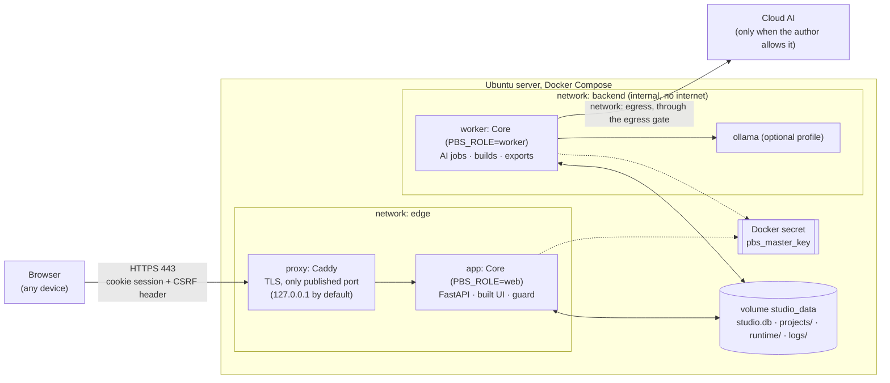

# ADR-0010: Self-hosted web application on Ubuntu (Phase 09)

Status: Accepted for Phase 09 (decisions P9-1 to P9-13 await the author's sign-off).
Date: 2026-11-23. Supersedes the desktop-packaging plan in ADR-0001 §6 and ARCHITECTURE §10.

## 1. Context

Phase 09 changes the product's shape: Personal Book Studio becomes a browser application that one
author self-hosts on an Ubuntu server with Docker Compose, reached over authenticated HTTPS. It is no
longer a desktop application. Existing features and stored books must keep working unchanged.

## 2. What the inspection found

Read: BUILD_STATE, ARCHITECTURE, SECURITY, DATA_MODEL, ROADMAP, ADR-0001 to 0009, Core's `config`,
`context`, `security/*`, `api/app.py`, the job runner, the Vite config, the UI API client, the test
fixtures and the Playwright fixtures.

| Area | Found | Browser-ready? |
|---|---|---|
| Desktop shell | **No Tauri or Electron code exists.** ADR-0001 planned a Tauri 2 shell for Phase 10; it was never started. | Yes: the UI has always run in a normal browser (Vite dev server + Core). |
| Native dialogs / client file paths | None. Imports are multipart uploads; every download is an HTTP response with `Content-Disposition`; no endpoint accepts a filesystem path from the client (checked every contract). | Yes. Nothing to replace. |
| Binding | Core refused any non-loopback `PBS_HOST`. | Needs a server mode. |
| Authentication | A 256-bit per-launch token written to `runtime/session.token`, injected by the Vite dev proxy as `X-PBS-Token`. No accounts: whoever could reach the proxy was "the user". | **No.** Unsafe on a network. |
| Credentials | Python `keyring` (OS credential store). A headless Ubuntu container has no keyring, so keys could only come from environment variables. | Needs a server key store. |
| UI serving | Only the Vite dev server served the UI. | Needs production serving. |
| Background work | Durable SQLite job runner (claims in one transaction, restart recovery) inside the web process. Publishing builds, covers, packages and audio export ran inside the HTTP request. | Runner is multi-process-safe already; long builds needed to move off the request. |
| Local AI | Ollama accepted only on loopback. In Docker it is a separate container (`ollama`). | Needs an operator-set private host list. |
| Database | SQLite (WAL, FTS5), Alembic migrations with pre-migration snapshots. | Yes, for one author on one host (P9-2). |
| Small desktop leftovers | Default workspace in the user's Documents folder; Windows ACLs via `icacls`; research user agent "(local desktop app)"; help text "this computer (127.0.0.1)". | Adjusted. |

## 3. Target architecture

* **Frontend**: the existing React/TypeScript SPA, built once and served by Core (`PBS_UI_DIST`).
* **Backend**: the existing FastAPI Core. No framework change.
* **Processes**: `python -m pbs_core serve` (web) and `python -m pbs_core worker`, one image.
* **Storage**: one named volume `/data` (the workspace layout is unchanged).

## 4. Decisions

**P9-1 Browser first; desktop packaging retired.** The Tauri plan (Phase 10 in the old roadmap) is
dropped: nothing was built, so nothing is removed except documentation. The `local` deployment stays
for development and single-machine use; it keeps the loopback-only rule.

**P9-2 Keep SQLite.** One author, one web process and one worker on one host. SQLite in WAL mode
handles that, and migrating would risk the data this phase must preserve. The worker takes an
exclusive OS file lock (`runtime/worker.lock`) so two runners can never share a workspace. The volume
must be a local disk, not NFS or SMB (SQLite locking is unreliable there).

**P9-3 One account per studio.** The product is a *personal* studio and multi-user is listed out of
scope in ROADMAP. Setup refuses a second account. Authorization is therefore "is this the signed-in
owner": the request guard denies every `/api` request without a valid session (deny by default, so a
new route cannot forget), and a test calls all 219 API operations without a session and expects 401.

**P9-4 Passwords: scrypt n=2^17, r=8, p=1** (128 MiB, the first scrypt setting in the OWASP Password
Storage Cheat Sheet, read 2026-11-23), Python standard library, no new dependency. Minimum 12
characters, maximum 1024; no composition rules. Unknown usernames take as long as wrong passwords.

**P9-5 Sessions.** 256-bit random token in an `HttpOnly`, `SameSite=Strict`, `Path=/` cookie; on
https it is `Secure` with the `__Host-` prefix. Only its SHA-256 is stored, so a database copy cannot
be replayed. Idle timeout 12 hours and absolute limit 14 days (both configurable). This is a judgement
for a personal writing tool used across a working day, not a figure from a standard. Changing the
password signs out other sessions; the server-side reset signs out all of them. Sessions are rows, so
a restart does not sign anyone out.

**P9-6 CSRF.** Each session has its own token, sent by the UI as `X-PBS-CSRF` on every POST, PUT,
PATCH and DELETE and compared in constant time. The sign-in endpoints need the header too (a
cross-site form cannot add headers). The existing Host, Origin and `Sec-Fetch-Site` checks stay, and
no CORS headers are ever sent.

**P9-7 First account.** While no account exists Core keeps a one-time code in
`runtime/setup-code.txt` (mode 0600, never logged); setup needs it, so whoever reaches the site first
cannot claim it. Alternative: `python -m pbs_core create-user` on the server.

**P9-8 Server key store.** Provider keys are encrypted with AES-256-GCM (`cryptography`, Apache-2.0 /
BSD) in `runtime/secrets.enc.json`, with the key name as associated data. The 32-byte master key is a
Docker secret outside the data volume, so a stolen volume or backup does not reveal keys. A wrong key
stops Core at startup (fail closed). Without a key file a server never falls back to a keyring: keys
can then come only from environment variables, and the UI says so. Local mode keeps the OS keyring.

**P9-9 TLS at the proxy.** Caddy terminates TLS (`tls internal` for LAN names, ACME for public names).
Core trusts `X-Forwarded-*` only from the proxy's fixed address, answers only to `PBS_PUBLIC_ORIGIN`
(plus loopback for health checks) and sends HSTS when that origin is https. Ports are published on
127.0.0.1 unless the operator sets `PBS_BIND_ADDRESS`. Docker-published ports bypass `ufw`, which is
why the bind address, not the host firewall, is the default control.

**P9-10 Long work leaves the request.** A durable `background_task` table runs publishing builds,
covers, packages and audio exports in the worker; the UI enqueues and polls `GET /api/tasks/{id}`.
Recovery mirrors AI jobs (re-queue once, then `interrupted`). The synchronous endpoints remain for
compatibility and tests. **Imports stay synchronous**: the upload itself is the slow part and
conversion of a capped upload is quick. Moving them is listed as a follow-up.

**P9-11 Private model hosts.** `PBS_LOCAL_AI_HOSTS` (environment only, plain host names) lets the egress
gate treat, for example, the `ollama` container as local. Nothing in the browser can add one. Ollama
sits on the internal-only network, so it has no internet access and no published port.

**P9-12 Sign-in throttling** in memory: 5 failures in 15 minutes per client address and per username,
then wait (HTTP 429 with `retry_after`). One web process serves the studio, so memory is enough.

**P9-13 Core serves the UI** with a strict CSP header (and the same policy as a meta tag in the
build), `nosniff`, `X-Frame-Options: DENY`, `Referrer-Policy: no-referrer`, COOP/CORP and a
Permissions-Policy. Hashed assets are cached for a year; everything else is revalidated.

## 5. Consequences

* The old `X-PBS-Token` and `runtime/session.token` are gone; the file is deleted on startup.
* Every test client now signs in. Schema head is `0010` (adds tables only).
* Not done in this phase: per-book backups still omit Phase 08 data (BUILD_STATE limitation); imports
  are synchronous; no multi-user; no automated backup of the Docker volume (documented commands only).
