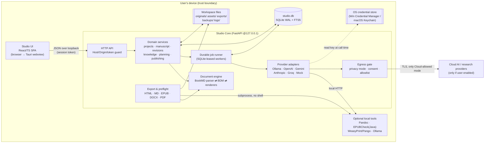
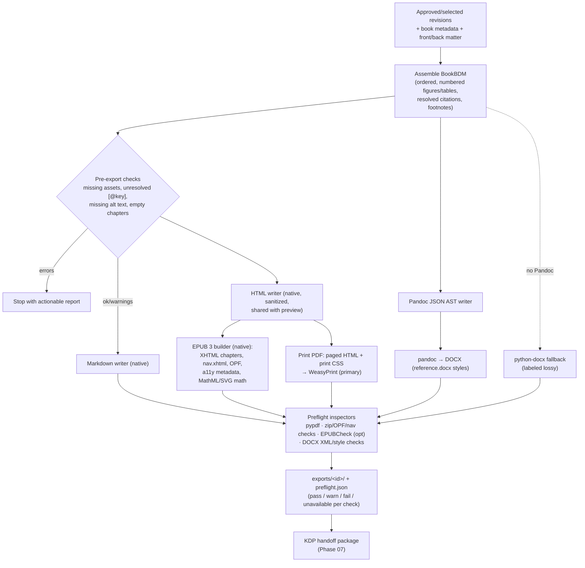

# Personal Book Studio — Architecture

Status: Draft v0.1 (Phase 00). Companion docs: `DATA_MODEL.md` (entities and schemas), `SECURITY.md` (threat model), `ADR/0001-stack.md` (stack and dependency assessment).

## 1. Shape of the system

PBS is a **local two-process application**:

1. **Studio UI**: React + TypeScript SPA. In development, Vite serves it in the user's browser. From Phase 10 it runs inside a Tauri 2 webview.
2. **Studio Core**: a Python FastAPI service bound to **127.0.0.1 only**. It owns the database, files, jobs, AI provider calls, import/export and validation. The UI is a thin client and never touches files directly.

In dev mode the Vite proxy makes them same-origin, so the browser needs no CORS. Under Tauri, Core runs as a sidecar process the shell starts and supervises.



### 1.1 Data flow: the core writing loop

```mermaid
sequenceDiagram
  participant U as Author (UI)
  participant C as Core API
  participant J as Job runner
  participant P as Provider adapter
  participant D as studio.db
  U->>C: Request "draft section S" (provider, model, budget)
  C->>C: Egress gate: privacy mode + consent check (fail closed)
  C->>D: INSERT job(status=queued, idempotency_key)
  J->>D: Claim job (lease, status=running)
  J->>D: Read brief, outline, retrieved chunks (as untrusted data)
  J->>P: Prompt (instructions ≠ data, delimited)
  P-->>J: Output + usage
  J->>D: INSERT proposal(job_id UNIQUE), usage record; job=succeeded
  U->>C: Review proposal (diff vs current revision)
  U->>C: Accept (expected_base_revision = N)
  C->>D: TX: INSERT revision N+1 (origin=ai_generated|ai_assisted), mark proposal accepted
  Note over C,D: Base mismatch → 409, user rebases; locked/approved blocks never replaced
```

## 2. Module layout (planned repository structure)

```
book_studio/
  apps/
    studio-ui/            React + TS + Vite (pnpm)
    studio-core/          Python 3.12 package `pbs_core` (uv)
      src/pbs_core/
        api/              FastAPI routers, request guards, error mapping
        domain/           pure domain logic (no I/O): state machines, validation
        services/         use cases (projects, manuscript, revisions, import, export...)
        document/         BookMD parser, BDM model, renderers, round-trip checks
        jobs/             queue, leases, workers, idempotency
        providers/        adapters + egress gate + usage/cost accounting
        storage/          SQLAlchemy models, repositories, workspace paths, atomic writes
        security/         token, host/origin guard, redaction, sanitization, safe paths
        migrations/       Alembic env + versions
      tests/              pytest (unit, integration, fidelity fixtures)
  packages/
    contracts/            OpenAPI-generated TS client + types (generated, committed)
  fixtures/               checked-in test manuscripts, DOCX/PDF/HTML samples, golden outputs
  e2e/                    Playwright specs
  desktop/                Tauri 2 shell (Phase 10 only)
  scripts/                dev setup, run, test, seed-demo (PowerShell + POSIX sh)
  docs/
```

**Contract rule:** Pydantic models in `pbs_core` are the API source of truth. The TS client and types in `packages/contracts` are generated from FastAPI's OpenAPI document (`openapi-typescript`). CI fails if the generated client is stale.

## 3. Workspace boundaries

| Boundary | Rule | Enforcement |
|---|---|---|
| Device ↔ network | No egress except provider calls that pass the **egress gate**, plus explicit user actions | A single `httpx` client factory, used only inside `providers/`. An import-linter contract forbids network libraries elsewhere. A test monkeypatches the socket layer and asserts zero egress in local-only mode |
| UI ↔ Core | Loopback only. Host-header allowlist, Origin check, per-launch session token | `security/guard.py` middleware (see SECURITY.md) |
| Project ↔ project | Every row carries `project_id`. Child FKs are **composite** `(project_id, id)`, so a row cannot reference another project's data. Services require a `ProjectContext` | DB constraints + repository API + isolation tests |
| Workspace root ↔ rest of disk | Every file path is resolved under `<workspace>/projects/<project_id>/…` from IDs, never from user-supplied names | `storage/paths.py` `safe_join()` rejects absolute paths, `..`, drive letters, UNC, NTFS ADS (`:`), reserved device names (`CON`, `NUL`, …) and symlink escapes |
| Trusted instructions ↔ untrusted content | Imported docs, web pages, knowledge chunks and model output are **data** | Prompt assembly uses typed `TrustedInstruction` / `UntrustedContent` parts. Untrusted parts are delimited and never parsed as tool calls (see SECURITY.md §5) |
| Proposal ↔ manuscript | AI writes only to `proposal`. Only an explicit accept writes a `chapter_revision` | Service API has no "AI writes revision" path. A DB trigger forbids revisions with `origin LIKE 'ai_%'` unless `accepted_proposal_id` is set |
| Originals / revisions | Immutable | SQLite `BEFORE UPDATE/DELETE` triggers `RAISE(ABORT)`. Files written once, read-only attribute set |

### 3.1 On-disk layout

Default workspace root (to be validated with the user): `%USERPROFILE%\Documents\Personal Book Studio` on Windows, `~/Documents/Personal Book Studio` on macOS. Overridable with `PBS_WORKSPACE`. Dev/test use `./.pbs-data/` (git-ignored) or a pytest temp directory.

```
<workspace>/
  studio.db                 single SQLite database (WAL)
  studio.db-wal / -shm
  runtime/session.token     per-launch random token (0600 / user-only ACL)
  logs/core-YYYYMMDD.jsonl  redacted structured logs, rotated
  db-backups/               automatic pre-migration snapshots
  projects/<project_id>/
    originals/sha256/ab/<sha256>.<ext>   immutable uploaded files
    assets/sha256/ab/<sha256>.<ext>      images & media (content-addressed, deduplicated)
    exports/<export_id>/                 one directory per export run + preflight.json
    packages/<package_id>/               KDP handoff packages
  backups/<project_slug>-<timestamp>.pbsbak.zip
```

The project directory is named by ID, never by title, so renames never move files. Human-readable names appear only in export file names, after sanitization.

## 4. Document engine (the fidelity backbone)

The full schema is in `DATA_MODEL.md §4`. Summary:

- **BookMD** is the authored surface: a constrained Markdown dialect (CommonMark + GFM tables and task lists + footnotes + `$…$`/`$$…$$` math + `{#id .class key=val}` attributes + `[@key]` citations + `:::` fenced divs for figures and callouts). Raw HTML is **disabled**.
- **BDM (Book Document Model)** is the canonical structure: a versioned JSON block tree with a stable ID on every block. It is derived deterministically from BookMD by one parser in Core (markdown-it-py + plugins + PBS rules). The UI never parses Markdown for persistence. Preview HTML is rendered by Core too, so preview and export share one code path.
- A **revision stores both**: `source_md` (exactly what the author typed) and `bdm_json` (plus `parser_version`, `content_hash`). Source is authoritative for text. BDM is authoritative for structure and IDs.
- **Block-ID reconciliation**: on save, the new BDM's blocks are matched to the previous revision's blocks (explicit `{#id}` first, then exact content hash, then position + similarity). Matched blocks keep their IDs; new blocks get new ULIDs. Citations, annotations, evidence links and comments anchor to block IDs.
- **Round-trip invariant** (tested on every fixture): `parse(serialize(parse(md))) == parse(md)` structurally, and `serialize(parse(md))` is idempotent after one normalization pass. Any node a renderer cannot represent raises a typed `FidelityWarning`, which is shown to the user and recorded in the export report.

## 5. Export pipeline



Rules:
1. **One structural source.** Every format derives from the same assembled BookBDM. HTML, EPUB and PDF share the HTML writer, so preview, ebook and print stay consistent.
2. **Determinism.** Same input + same tool versions → byte-identical Markdown, HTML and EPUB (fixed zip timestamps, sorted entries, `mimetype` stored first and uncompressed). PDF is compared structurally (page count, page sizes, text per page, embedded fonts), because producer timestamps are pinned but engines may vary.
3. **Tool capability checks.** External tools are found by explicit configured path or PATH, version-checked, and run with `subprocess.run([...], shell=False, timeout=…)` in a temp working directory. If a tool is missing, its feature is shown as unavailable with install guidance. It never silently degrades.
4. **Validators report four states:** `pass | warn | fail | unavailable`. Never "pass" when a validator didn't run.
5. **MOBI/AZW3** (optional) goes through Calibre `ebook-convert` if the user installed it. It is labeled "external conversion, not required by KDP".
6. **Math:** LaTeX → MathML (`latex2mathml`) for HTML and EPUB. For PDF, MathML → SVG (`ziamath`), because WeasyPrint does not render MathML. For DOCX, Pandoc emits native OMML. Rendering failures fall back to monospace LaTeX source with a warning.

## 6. Durable job system

- `job` rows are the single source of truth: no in-memory-only jobs. Workers are asyncio tasks inside Core, with a configurable concurrency limit (default 2; per-provider limits).
- **Claiming:** `UPDATE job SET status='running', lease_owner=?, lease_expires_at=? WHERE id=(SELECT id FROM job WHERE status='queued' AND run_after<=now ORDER BY priority, created_at LIMIT 1) RETURNING *`, inside a `BEGIN IMMEDIATE` transaction. Heartbeats extend the lease.
- **Restart recovery:** at startup, `running` jobs with expired leases become `queued` if `attempt < max_attempts` and every incomplete step is idempotent. Otherwise they become `interrupted`, awaiting the user's choice (resume / cancel).
- **Steps:** long jobs (whole-book drafting) are split into `job_step` rows, each with an `idempotency_key`. Completed steps are never re-run on resume.
- **Exactly-once final commit:** outputs are written with `UNIQUE(job_id, step_key)` on `proposal` / `export_run`. A retry that finds an existing output records the attempt and reuses the output.
- **Cancellation:** a cooperative flag checked between provider stream chunks and steps. In-flight HTTP is cancelled through an `httpx` task cancel. Status moves to `cancelled`; partial output is kept as a non-applicable draft for inspection.
- **Progress:** stages (`preparing → calling_model → validating → saved`) plus counts (`3/12 sections`). No invented percentages.

## 7. Provider layer

```
ProviderAdapter (Protocol)
  list_models() -> [ModelInfo]           # discovered; capabilities flagged "reported" vs "user-declared"
  generate(req: GenRequest) -> stream of chunks + final Usage
  generate_structured(req, schema) -> validated Pydantic object (retry on validation error, bounded)
  health() -> ProviderHealth
```

- Adapters: `ollama` (local HTTP at a user-configured URL, default `http://127.0.0.1:11434`), `openai`, `anthropic`, `gemini`, `groq`, and `mock` (deterministic, offline, used in CI and in the acceptance scenario).
- The **egress gate** wraps every non-local adapter. In local-only mode it raises `EgressBlocked` before any socket opens. A local adapter pointed at a non-loopback host counts as cloud.
- **Cost accounting:** `price_table` rows are user-maintained (`source_url`, `as_of`). Cost = usage × price when both are known. Otherwise the value is `null` and shows as "unknown". Pre-run estimates are labeled "estimate".
- SDKs are verified against current official docs in Phase 03 (see ADR-0001 §4). Retries use exponential backoff with jitter on 429/5xx only. Every call has a timeout.

## 8. Frontend architecture

- React 19 + TypeScript (strict) + Vite. React Router (declarative routes). TanStack Query for server state; no global client store unless needed.
- **React Aria Components** (Adobe, Apache-2.0) for accessible primitives (dialogs, menus, listboxes, tabs, drag-and-drop with keyboard alternatives), styled with original CSS-module components over design tokens (CSS custom properties). There is no vendor theme, so there is no borrowed trade dress.
- App shell: left navigation (Library, New Book, Research, Manuscripts, Knowledge, Publishing, AI Settings, Activity, Help). A persistent top-right **privacy indicator**. A job tray.
- Unavailable features render a real "Not yet available — Phase NN" panel, never mock data.
- The editor (Phase 01: accessible `<textarea>` Markdown source + server-rendered preview; Phase 02: component chosen per ADR-0002 after a fidelity bake-off, with CodeMirror 6 the leading candidate for source mode).

## 9. Error handling and logging

- Core returns RFC 9457 `application/problem+json` with a stable `type` code. The UI maps codes to actionable messages. A top-level React error boundary plus per-route boundaries.
- Logging: `structlog` JSON to `logs/`. A redaction processor scrubs known secret patterns (`sk-…`, `Bearer …`, `x-api-key`, `AIza…`, `gsk_…`) and any value whose key matches `/key|token|secret|password|authorization/i`. Manuscript text is **not logged** by default (only IDs, lengths and hashes).
- The Activity log (user-facing) is a separate `activity_event` table holding human-readable, non-secret events.

## 10. Desktop packaging (Phase 10 preview)

The Tauri 2 shell starts Core as a sidecar binary (PyInstaller onedir, per-OS/arch), passing the workspace path, a random port and the session token through environment variables and stdin, not argv. The shell owns single-instance handling and shutdown. Constraints are tracked in ADR-0001 §6 and the risk register (notarization of every bundled dylib on macOS, PyInstaller antivirus false positives on Windows, the Pango/GTK runtime for WeasyPrint, a Java runtime for EPUBCheck).

## 11. Risk register

Likelihood and Impact: H/M/L. Owner: the phase that must retire the risk.

| # | Risk | L | I | Mitigation / fallback | Phase |
|---|---|---|---|---|---|
| R1 | Editor strips structures (tables, math, footnotes, IDs) → silent data loss | M | H | Markdown source is authoritative. Round-trip fidelity suite on fixtures gates every editor change. WYSIWYG only if it passes the suite | 01–02 |
| R2 | Block-ID reconciliation mis-matches after heavy edits → citations or annotations re-anchor wrongly | M | M | Explicit `{#id}` always wins. Low-confidence matches flagged for review. Orphaned anchors are listed, not dropped | 02, 04 |
| R3 | WeasyPrint on Windows needs the Pango/GTK runtime (MSYS2); macOS bundling of dylibs | H | H | Phase 02 spike. Fallback B: Typst via `typst` PyPI wheel (BDM → Typst writer). Fallback C: headless Chromium print (page margin boxes supported in recent Chromium) | 02 spike, 07 |
| R4 | Pandoc not installed / GPL bundling obligations | M | M | Pandoc is optional, detected and user-installed (winget/brew). DOCX falls back to python-docx with labeled losses. Do not bundle in distributed builds without satisfying GPL | 02, 07, 10 |
| R5 | EPUBCheck needs Java (not installed) | H | L | Optional. Report "validation unavailable". Native structural checks always run | 07 |
| R6 | Python 3.15 is the system default; many wheels (pydantic-core, lxml, nh3) may lag for brand-new CPython | H | M | Pin **CPython 3.12** via `uv` (`.python-version`). Bump only with an ADR after the wheel matrix passes | 01 |
| R7 | Cloud SDK churn / model names change | H | L | Adapters behind a Protocol. Models discovered, not hard-coded. Contract tests use recorded fixtures plus opt-in live smoke tests | 03 |
| R8 | Prompt injection from imported sources leads to exfiltration or unwanted actions | M | H | No tool-use for untrusted content. Delimiting. Output is a proposal only. No URL fetch triggered by model output. Injection fixtures in tests | 03–06 |
| R9 | Hallucinated citations or statistics | H | H | Citations only from evidence-ledger chunk IDs. Validator rejects any citation key not in the ledger. "Unverified" flag | 04, 06 |
| R10 | Double-applied AI output after crash/retry | M | H | Unique `(job_id, step_key)` outputs. Accept requires `expected_base_revision`. Restart tests | 03 |
| R11 | Malicious DOCX/EPUB/ZIP imports (zip bomb, XXE, traversal) | M | H | `defusedxml`. Zip ratio/size/entry limits. `safe_join`. Size caps. Fuzz fixtures | 02 |
| R12 | KDP specs change (trim sizes, cover math, AI disclosure wording) | H | M | Versioned spec table with `source_url` + `checked_on`, rule version shown in UI, "verify in KDP Previewer" step. No approval promise | 07 |
| R13 | Public GitHub repo: risk of committing manuscripts, keys, or personal data | M | H | `.gitignore` for `.pbs-data/`, `*.db`, workspaces, `.env*`. Fixtures must be synthetic or public-domain. Pre-commit secret scan (gitleaks) | 01 |
| R14 | Licensing contamination (AGPL: PyMuPDF, EbookLib) | M | M | Banned-license list checked in CI (`pip-licenses`, `license-checker`). Approved alternatives listed in ADR-0001 | 01+ |
| R15 | sqlite-vec / extension loading unavailable in some Python builds | M | L | Embeddings optional. Fallback: numpy brute-force cosine (fine at about 10k chunks) | 04 |
| R16 | Fonts: licensing for embedding in PDF/EPUB | M | M | Ship only OFL fonts (e.g., Source Serif 4, Inter, JetBrains Mono, STIX Two for math). Record licenses in the package | 07 |
| R17 | PyInstaller sidecar AV false positives; macOS notarization; unsigned builds | H | M | Document unsigned-build limitations. CI per-OS runners. Consider Nuitka | 10 |
| R18 | Scope creep before fidelity and storage are proven | H | H | Phase gates (ROADMAP). Export spikes early. Dashboard polish deferred | all |
| R19 | Single-file DB corruption | L | H | WAL, `synchronous=FULL` on commit paths, `PRAGMA integrity_check` at startup (quick_check), pre-migration snapshots, project ZIP backups | 01–02 |
| R20 | Kindle MathML support is limited; math may render poorly on devices | M | M | EPUB option to render math as SVG images with alt text (LaTeX source). Preview in Kindle Previewer (manual) | 07 |
