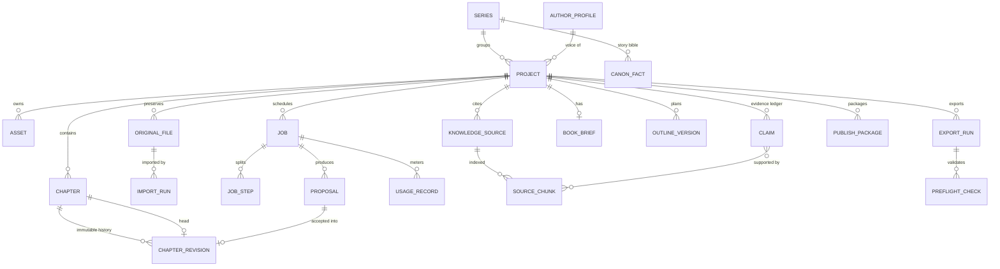

# Personal Book Studio — Data Model

Status: Draft v0.1 (Phase 00). The **Phase** column shows when each table first lands; later tables are design intent and may be refined by ADRs. The DB is one SQLite file, `studio.db` (see ARCHITECTURE §3).

## 1. Conventions

- **IDs:** 26-character Crockford ULIDs stored as `TEXT` (time-sortable, URL-safe), generated in Core. Exported references use ULIDs, never autoincrement integers.
- **Timestamps:** UTC ISO-8601 `TEXT` (`2026-11-22T18:04:05.123Z`), set by Core.
- **Project scoping:** every project-owned table has `project_id TEXT NOT NULL`, a `UNIQUE(project_id, id)`, and child FKs declared as **composite** `(project_id, parent_id) → parent(project_id, id)`. A row cannot point at another project's row (DB-enforced isolation).
- **Soft vs hard delete:** user-facing "delete" means archive (`archived_at`). Hard delete is an explicit purge service that writes an `activity_event`.
- **Immutability:** `chapter_revision`, `original_file`, `source_chunk` and `usage_record` have `BEFORE UPDATE` / `BEFORE DELETE` triggers that `RAISE(ABORT, 'immutable')`. Project purge is the sole exception: it runs with a connection-scoped flag table (`_purge_ctx`) that the triggers check.
- **Enums** are `TEXT` with `CHECK` constraints. Their Python mirrors live in `domain/enums.py`.
- **JSON columns** (`TEXT` holding JSON) have Pydantic schemas and a `schema` tag inside the JSON (e.g. `"schema":"bdm/1"`).
- **PRAGMAs** on every connection: `foreign_keys=ON`, `journal_mode=WAL`, `synchronous=FULL` (as built in Phase 01: every commit is durable; single-user write volume makes the cost negligible), `busy_timeout=5000`. Every transaction starts with `BEGIN IMMEDIATE` to avoid WAL lock-upgrade failures. A `pbs_fold()` SQL function (Python `str.casefold`) is registered per connection for Unicode-aware search and sort.

## 2. Entities (ER overview)



### 2.1 Core tables (Phase 01)

**`project`**
| Column | Type | Notes |
|---|---|---|
| id | TEXT PK | ULID |
| title | TEXT NOT NULL | 1–300 chars |
| subtitle | TEXT | |
| project_type | TEXT | `nonfiction, technical, course, workbook, memoir, fiction, serial` |
| language | TEXT | BCP-47, default `en` |
| audience | TEXT | free text |
| target_word_count | INTEGER | nullable, ≥0 |
| publication_formats | TEXT JSON | subset of `["ebook","paperback","hardcover"]` |
| author_name | TEXT | author or pen name as free text (Phase 01) |
| is_demo | INTEGER 0/1 | set only by the explicit demo seed script |
| author_profile_id | TEXT FK | nullable (Phase 04) |
| series_id | TEXT FK | nullable (Phase 08) |
| status | TEXT | `active, archived` |
| created_at / updated_at / archived_at | TEXT | |
| duplicated_from_id | TEXT | provenance when duplicated |

Indexes: `(status, updated_at)`. Library search (as built) is a case-folded substring match (`pbs_fold(col) LIKE … ESCAPE '\'`) over title, subtitle, audience and author. Substring matching suits a personal library better than FTS token matching. FTS5 is reserved for manuscript and source search (Phase 04).

**`chapter`** (a node in the manuscript tree; parts, chapters and sections share one table)
| Column | Type | Notes |
|---|---|---|
| id, project_id | TEXT | composite unique |
| parent_id | TEXT | nullable, composite FK to chapter; null = top level |
| kind | TEXT | `part, chapter, section, front_matter, back_matter` |
| position | TEXT | fractional index key (LexoRank-style), so reorders touch one row |
| title | TEXT NOT NULL | |
| slug | TEXT | unique per project, sanitized |
| status | TEXT | `planned, draft, in_review, approved` |
| locked | INTEGER 0/1 | locked chapters reject AI proposals |
| target_word_count | INTEGER | |
| head_revision_id | TEXT | composite FK → chapter_revision; updated in the same TX as the revision insert |
| head_revision_no | INTEGER | optimistic-concurrency token |
| outline_node_id | TEXT | stable link to the outline (Phase 05) |
| created_at / updated_at / archived_at | TEXT | |

**`chapter_revision`** (immutable)
| Column | Type | Notes |
|---|---|---|
| id, project_id, chapter_id | TEXT | composite FK |
| revision_no | INTEGER | 1..n per chapter, `UNIQUE(chapter_id, revision_no)` |
| parent_revision_id | TEXT | the base it was derived from |
| origin | TEXT | `human, ai_generated, ai_assisted, imported, restored, system_migration` |
| source_md | TEXT NOT NULL | exactly what was authored |
| bdm_json | TEXT NOT NULL | canonical structure (`bdm/1`) |
| parser_version | TEXT | e.g. `bookmd-1.0.0` |
| content_hash | TEXT | sha256 of normalized source_md |
| word_count | INTEGER | computed from BDM text nodes |
| label / note | TEXT | user checkpoint label and notes |
| accepted_proposal_id | TEXT | required when origin is `ai_*`; trigger-enforced |
| restored_from_revision_id | TEXT | set when origin = restored |
| import_run_id | TEXT | set when origin = imported |
| created_at | TEXT | |

**`activity_event`**: `id, project_id (nullable), kind, summary, ref_type, ref_id, created_at`. Human-readable, never holds secrets or manuscript text.

**`export_run`** (minimal in Phase 01; extended in Phase 07, see §2.4): `id, project_id, format (markdown first), revision_set_json` (chapter_id → revision_id used), `status, output_path (relative), sha256, byte_size, warnings_json, started_at, finished_at`.

**`app_setting`**: `key TEXT PK, value_json TEXT`. Non-secret settings only (privacy mode, workspace prefs, UI prefs).

**`schema_meta`**: Alembic's `alembic_version` plus `app_min_version`, which refuses to open a DB written by a newer app.

**Migrations as built (Phase 01):** `0001_baseline` creates `project`, `chapter`, `chapter_revision`, `activity_event`, `export_run`, `app_setting` and `_purge_ctx`, plus four triggers: revision immutability (UPDATE and DELETE), the AI-origin rule that requires `accepted_proposal_id`, and sequential `revision_no`. `0002_backup_run` adds `backup_run` (the manifest/1 bookkeeping table; the ZIP writer is Phase 02). Revisions written in Phase 01 carry `parser_version="bookmd-0.1"` and a provisional `bdm/0` structure: top-level blocks with exact source spans, IDs reused for unchanged blocks. Phase 02 introduces bookmd-1 / `bdm/1` and re-derives BDM lazily from `source_md`.

### 2.2 Phase 02 tables

- **`asset`**: `id, project_id, sha256, mime, byte_size, width_px, height_px, original_name, storage_path (relative), alt_text_default, license_note, created_at`. `UNIQUE(project_id, sha256)`.
- **`original_file`** (immutable): `id, project_id, sha256, original_name, mime_detected, byte_size, storage_path, received_at`.
- **`import_run`**: `id, project_id, original_file_id, importer (md|txt|docx-pandoc|docx-mammoth|html|pdf-text), status, lossy (0/1), report_json, created_at, finished_at`.
- **`annotation`**: `id, project_id, chapter_id, block_id, kind (comment|flag|todo), body, resolved_at`, anchored to a BDM block ID.
- **`backup_run`** (landed early, migration 0002): `id, project_id, path, manifest_sha256, schema_revision, created_at, kind (manual|pre_migration|pre_restore)`.

### 2.3 Phase 03 tables

- **`provider_config`**: `id, kind (ollama|openai|anthropic|gemini|groq|mock), label, base_url, is_local (derived from the loopback check), credential_ref` (keychain service/account name only, **never the secret**), `enabled, created_at`.
- **`model_info`**: `id, provider_config_id, model_name, capabilities_json` (each capability tagged `reported|user_declared|unknown`), `context_tokens (nullable), discovered_at`.
- **`task_route`**: `task (brainstorm|research|outline|draft|revise|summarize|translate|review), provider_config_id, model_name, params_json`.
- **`price_table`**: `provider_kind, model_name, input_per_mtok, output_per_mtok, currency, source_url, as_of, entered_by (user)`. Without a matching row, cost is unknown.
- **`job`**: `id, project_id, chapter_id (nullable), task, provider_config_id, model_name, status, priority, attempt, max_attempts, idempotency_key UNIQUE, payload_json` (references by ID, not big blobs), `stage, progress_done, progress_total (nullable), lease_owner, lease_expires_at, run_after, error_code, error_detail, cancel_requested (0/1), budget_json, created_at, started_at, finished_at`.
- **`job_step`**: `id, job_id, step_key, status, attempt, output_ref, error, started_at, finished_at`, `UNIQUE(job_id, step_key)`.
- **`job_log`**: `id, job_id, ts, level, message` (redacted).
- **`proposal`**: `id, project_id, chapter_id, job_id, step_key, base_revision_id, kind (replace_chapter|replace_blocks|insert_blocks|selection_edit), payload_md, payload_bdm_json, target_block_ids_json, status, decided_at, decided_note, provenance_json` (provider, model, prompt template id+version, retrieved chunk IDs), `UNIQUE(job_id, step_key)`.
- **`usage_record`** (immutable): `id, job_id, provider_kind, model_name, input_tokens, output_tokens, reported_by_provider (0/1), cost_amount (nullable), currency, price_row_ref, is_estimate (0/1), created_at`.

### 2.4 Phase 04–08 tables (design intent)

- **Knowledge:** `knowledge_library (id, scope project|shared, project_id nullable, name)`, `project_library_link`, `knowledge_source (id, library_id, kind file|url|interview, title, uri, original_file_id, retrieved_at, content_sha256, enabled, tags_json, index_status)`, `source_chunk (id, source_id, ordinal, text, heading_path, page_from, page_to, char_start, char_end, sha256)` (immutable), `source_chunk_fts` (FTS5, external content), `chunk_embedding (chunk_id, model, dim, vector BLOB)` (optional).
- **Evidence ledger:** `claim (id, project_id, chapter_id, block_id, text, status, citation_key, created_by human|ai, reviewer_note)`, `claim_support (claim_id, chunk_id, quote, locator, support_strength user_rated)`, `citation (key, project_id, csl_json, source_id)`.
- **Voice / interviews:** `author_profile (id, display_name, pen_name, style_guide_md, stats_json)`, `voice_sample (id, author_profile_id, original_file_id, rights_attested_at)`, `interview_answer (id, project_id, question, answer_verbatim, recorded_at, source_kind typed|transcript, transcript_ref)`.
- **Planning:** `book_brief (project_id PK, brief_json, approved_revision)`, `outline_version (id, project_id, version_no, outline_json, status draft|approved|superseded, approved_at)`. Outline nodes carry stable `node_id`s that map to `chapter.outline_node_id`. `research_finding (id, project_id, kind measured|heuristic|note, text, source_uri, retrieved_at, provider)`.
- **Reviews:** `review_run (id, project_id, kind, scope_json, status, job_id)`, `review_finding (id, review_run_id, chapter_id, block_id, rule, severity, message, evidence_json, state open|dismissed|fixed)`.
- **Publishing:** `template (id, kind interior|cover|matter, name, version, config_json)`, `export_run (id, project_id, format, revision_set_json, template_id, tool_versions_json, status, output_path, sha256, started_at, finished_at)`, `preflight_check (id, export_run_id, check_id, rule_version, result pass|warn|fail|unavailable, details_json)`, `cover_design (id, project_id, kind ebook|print_wrap, layers_json, spec_ref, page_count_used)`, `kdp_spec (id, key, value_json, source_url, checked_on)`, `publish_package (id, project_id, path, manifest_json, created_at)`, `disclosure_checklist (project_id, answers_json, derived_stats_json, updated_at)`.
- **Series / translation / audio:** `series (id, name)`, `canon_fact (id, series_id, entity_type character|location|thread|event, entity_id, field, value, status canon|suggested|rejected, source_ref)`, `edition (id, project_id, source_project_id, language, derived_from_revision_set_json)`, `audio_render (id, project_id, chapter_id, revision_id, provider, path, duration_ms, alignment_json)`.

## 3. State machines

### 3.1 Project
```
active ──archive──▶ archived ──unarchive──▶ active
archived ──purge (explicit, confirmed, backup offered)──▶ [deleted]
any ──duplicate──▶ new active project (duplicated_from_id set; each chapter's HEAD copied as
                   revision 1 with origin=imported, note "duplicated from <id>"; history not copied)
```

### 3.2 Chapter status (author-controlled)
```
planned ─▶ draft ─▶ in_review ─▶ approved
   ▲         ▲          │            │
   └─────────┴──────────┴── (author may move back any time; recorded in activity)
locked: orthogonal flag. When locked=1 or status=approved, AI proposals targeting the chapter
        are rejected at creation (409 Locked). Human edits on approved chapters require
        an explicit "reopen for edit" (status → in_review) confirmation.
```

### 3.3 Revision lifecycle
Revisions have no state. They are append-only. `chapter.head_revision_id` moves forward only:
- **Save (human):** `expected_head_no == chapter.head_revision_no`, else **409 Conflict** with both versions. The new revision gets `origin=human`.
- **Accept proposal:** `proposal.base_revision_id == head`, else the proposal becomes `stale` and the user can rebase (re-diff against the head) or discard. The new revision gets `origin=ai_generated` (proposal content wholly model-written) or `ai_assisted` (selection edits, human-initiated rewrites of human text). The classification rule is versioned and documented for the KDP checklist.
- **Restore(r):** copies `r.source_md` into a new revision, `origin=restored`, `restored_from_revision_id=r.id`. Newer revisions stay in history.

### 3.4 Proposal
```
pending ──accept──▶ accepted (creates revision)
pending ──reject──▶ rejected
pending ──head moved──▶ stale ──rebase──▶ pending (new base) | ──discard──▶ rejected
pending ──target locked/approved──▶ blocked (cannot accept until unlocked by the user)
```

### 3.5 Job
```
queued ──claim──▶ running ──ok──▶ succeeded
running ──error(retryable, attempt<max)──▶ queued (run_after = backoff)
running ──error(final)──▶ failed ──user retry──▶ queued (attempt reset optional)
queued|running ──cancel──▶ cancelling ──▶ cancelled
running ──lease expired at startup──▶ queued (idempotent) | interrupted (needs user)
interrupted ──resume──▶ queued | ──cancel──▶ cancelled
```
Each transition is written in one transaction together with a `job_log` row.

### 3.6 Import run
`received → analyzing → preview_ready → (user confirms) committing → completed | failed | cancelled`. The original file is persisted at `received` and never deleted by a failed import.

### 3.7 Export run
`queued → assembling → rendering → validating → completed (with pass/warn/fail summary) | failed | cancelled`. A **completed export with failing checks is still completed**; the report says what failed.

### 3.8 Claim (evidence ledger, Phase 04)
`unverified → supported (≥1 claim_support, human-confirmed) | disputed | removed`. AI may *propose* supports but cannot mark a claim `supported`.

### 3.9 Canon fact (Phase 08)
`suggested → canon (author approves) | rejected`. Only `canon` facts are used as continuity ground truth.

## 4. Editing document schema: BookMD and BDM

### 4.1 BookMD (authoring dialect, `bookmd-1`)

| Construct | Syntax | Notes |
|---|---|---|
| Headings | `#`…`######`, optional `{#id}` | In a chapter, H1 = chapter title (optional), H2+ = sections |
| Paragraph, emphasis, strong, strike, inline code, sub/sup | CommonMark + `~~x~~`, `~x~`, `^x^` | |
| Lists | `-`, `1.`, task `- [ ]` | Nested |
| Block quote | `>` | |
| Link | `[text](url "title")`, autolinks | Allowed schemes: `http, https, mailto, #anchor, pbs:` (internal) |
| Table | GFM pipe tables + optional caption: a following `: Caption {#tbl-id}` line | Alignment preserved |
| Code | fenced with ```` ```lang {#lst-id caption="…"} ```` | Content is byte-exact; never reflowed |
| Math | `$inline$`, `$$display$$ {#eq-id}` | LaTeX source preserved verbatim |
| Figure | `{#fig-id alt="Alt text" width=60%}` alone in a paragraph | **Caption and alt are distinct.** Missing alt raises an accessibility finding |
| Footnote | `[^n]` + `[^n]: text` | |
| Citation | `[@key]`, `[@key, p. 12]`, `[@a; @b]` | Keys must resolve to `citation` rows (Phase 04). Unresolved keys are flagged |
| Divs | `::: {.callout-note #id}` … `:::` | Classes: `callout-*`, `exercise`, `answer`, `epigraph`, `pagebreak`, `figure` |
| Raw HTML | **Disabled**: rendered as literal text | Prevents XSS. HTML imports are converted, not passed through |
| Comments | `<!-- -->` | Disallowed in source. Annotations live in the DB |

The parser is **markdown-it-py** (CommonMark-compliant) with `mdit-py-plugins` (footnote, dollarmath, attrs, container, tasklists, deflist) and PBS rules for citations and figure attributes. Parser output is validated against the BDM Pydantic schema.

### 4.2 BDM (`bdm/1`), the canonical structure

```jsonc
{
  "schema": "bdm/1",
  "chapter_id": "01J…",
  "blocks": [
    { "id": "b_01J…", "type": "heading", "level": 2, "attrs": {"anchor": "why-it-matters"},
      "inlines": [ {"t": "text", "v": "Why it matters"} ],
      "meta": { "origin": "human", "approval": "approved", "src_range": [0, 18] } },
    { "id": "b_…", "type": "paragraph", "inlines": [
        {"t":"text","v":"Energy is "}, {"t":"math","display":false,"tex":"E=mc^2"},
        {"t":"cite","items":[{"key":"einstein1905","locator":"p. 3"}]},
        {"t":"footnote_ref","ref":"fn1"} ] },
    { "id": "b_…", "type": "figure", "asset": "01J…", "alt": "Bar chart of…",
      "caption": [ {"t":"text","v":"Results by year"} ], "attrs": {"anchor":"fig-results","width":"60%"} },
    { "id": "b_…", "type": "table", "align": ["left","right"], "header": [[...],[...]],
      "rows": [[[...],[...]]], "caption": [...], "attrs": {"anchor":"tbl-1"} },
    { "id": "b_…", "type": "code", "lang": "python", "text": "print('hi')\n", "attrs": {"anchor":"lst-1","caption":"Hello"} },
    { "id": "b_…", "type": "math_block", "tex": "\\int_0^1 x\\,dx", "attrs": {"anchor":"eq-1"} },
    { "id": "b_…", "type": "list", "ordered": false, "task": false, "items": [ { "blocks": [ ... ] } ] },
    { "id": "b_…", "type": "quote", "blocks": [ ... ] },
    { "id": "b_…", "type": "div", "classes": ["callout-note"], "blocks": [ ... ] },
    { "id": "b_…", "type": "thematic_break" }
  ],
  "footnotes": { "fn1": [ { "id": "b_…", "type": "paragraph", "inlines": [ ... ] } ] }
}
```

Inline node types: `text, emph, strong, strike, sub, sup, code, link{href,title}, math{tex,display}, cite{items}, footnote_ref{ref}, line_break, soft_break, image_inline{asset,alt}`.

`meta.origin` ∈ `human | ai_generated | ai_assisted | imported` and `meta.approval` ∈ `suggestion | approved` are carried per block. They drive the always-visible badges (FR-UX-1). They are **derived and stored**, not typed by the user: blocks introduced by an accepted proposal take the proposal's origin, and a later human edit of that block changes it to `ai_assisted`.

### 4.3 Invariants (tested)
1. Every block has a unique `id` within the project. Anchors (`attrs.anchor`) are unique per project after export assembly (collisions get a deterministic suffix plus a warning).
2. `code.text` and `math*.tex` are preserved byte-for-byte through parse → BDM → serialize → parse.
3. `figure.alt` and `figure.caption` are never merged.
4. Unknown or unsupported constructs become an `unsupported` block holding the raw source span plus a `FidelityWarning`. Content is never dropped.
5. `serialize_bookmd(bdm)` is a normal form: `parse(serialize(parse(x))) ≡ parse(x)`.

### 4.4 Assets in documents
Documents reference assets by `asset:<asset_id>`. Never file paths. Renderers resolve assets through the asset table. Exports copy them into the output with sanitized, deterministic names (`fig-<n>-<sha8>.<ext>`). Reordering chapters never changes asset IDs, block IDs or citation keys, so references never orphan.

### 4.5 Book assembly model
`BookBDM = { metadata, front_matter[], body[chapter BDM in tree order], back_matter[], citations{}, assets{} }`. Numbering (Figure 3.2, Table 1.1, Listing 4) is computed at assembly time, never stored in the source, so reordering stays correct.

## 5. Schema migration strategy

1. **Alembic** with `render_as_batch=True` (SQLite ALTER limits). One linear history, no branches. Every migration has an `upgrade`. `downgrade` is provided where safe, but **user rollback = restore the pre-migration snapshot**, not downgrade.
2. **At startup:** compare the DB revision with the app head.
   - DB older → `PRAGMA quick_check`, write a snapshot to `db-backups/studio-<rev>-<ts>.db` using the SQLite online backup API, run migrations in a transaction where possible, verify (`foreign_key_check`, row counts on core tables), record `activity_event`.
   - DB newer than the app → refuse to open, with a clear message (never auto-downgrade).
3. **JSON payload schemas** (`bdm/1`, `outline/1`, `manifest/1`) carry their own version tags. Readers upcast old versions in code (pure functions with tests). A data migration rewrites stored JSON only when necessary, and then via a **new revision row**, `origin=system_migration`, never by UPDATE.
4. **Parser upgrades** (`parser_version` bump) never rewrite old revisions. BDM is re-derived lazily when needed, and if it differs, the next save records it.
5. **Migration tests:** checked-in fixture DBs for each released schema head (`fixtures/db/rev_<id>.db`, synthetic data). CI migrates each to head and runs invariants. Every migration PR adds a fixture.
6. **Backup ZIP format** (`manifest/1`): `manifest.json` (app version, schema rev, project row, file list with sha256 and size), `data/*.jsonl` (rows per table, project-scoped), `files/originals/…`, `files/assets/…`. Restore validates checksums, rejects unsafe paths, upcasts the manifest, and imports into a **new** project ID (with an option to keep the title + " (restored)").
